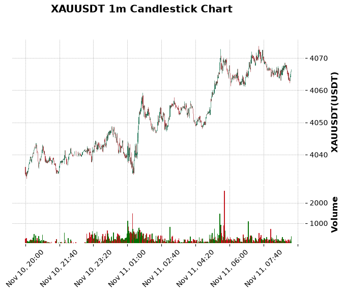
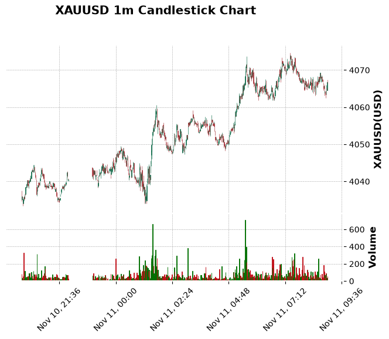

# Gold Spread Mean-Reversion Backtest

A Python research project exploring the one-minute price spread between **Binance XAUUSDT** and **COMEX gold futures (`GC=F`)**, with a rolling Z-score mean-reversion strategy and entry-threshold sensitivity analysis.

The project combines market-data collection, candlestick visualisation, exploratory spread statistics, and a simplified backtest. It investigates whether deviations from the recent average spread provide potential convergence signals.

## Research Question

How does the price difference between the two gold markets behave, and how sensitive is a simple mean-reversion strategy to its entry Z-score threshold?

The spread is defined as:

```text
Spread = COMEX gold futures close − Binance XAUUSDT close
```

A positive spread means COMEX is priced above Binance. A long-spread position represents buying the COMEX leg and selling the Binance leg; a short-spread position represents the reverse. The backtest models changes in this spread directly, rather than executing or sizing individual futures contracts.

## Features

- Download one-minute Binance candles and COMEX gold futures data.
- Align observations by timestamp and retain matching minutes.
- Plot candlestick charts and the raw price spread.
- Examine descriptive statistics, autocorrelation, and rolling mean and volatility.
- Compare rolling windows of 30, 60, 120, and 240 observations.
- Backtest a layered mean-reversion strategy using lagged signals.
- Compare entry thresholds using annualised Sharpe ratios and equity curves.

## Project Files

| File or folder                              | Purpose                                                                                                     |
| ------------------------------------------- | ----------------------------------------------------------------------------------------------------------- |
| `BinanceAPI.py`                           | Downloads 50,000 one-minute candles using the Binance continuous-klines endpoint and saves the Binance CSV. |
| `COMEX_data.py`                           | Downloads one-minute `GC=F` data through `yfinance`.                                                    |
| `K-charts.ipynb`                          | Plots candlestick charts and checks for timestamp gaps.                                                     |
| `spread.ipynb`                            | Aligns the two datasets, constructs the spread, and plots its behaviour.                                    |
| `Stat_relation.ipynb`                     | Explores spread statistics, autocorrelation, and rolling-window choices.                                    |
| `strategy.py`                             | Runs the backtest and entry-threshold sensitivity analysis.                                                 |
| `para_eva.ipynb`                          | Empty notebook reserved for future parameter evaluation.                                                    |
| `XAUUSDT diagrams/`                       | Existing research figures and equity-curve images.                                                          |
| `XAUUSDT_chart.png`, `XAUUSD_chart.png` | Existing candlestick figures; the latter uses COMEX futures data.                                           |
| `.gitignore`                              | Excludes raw market data, environments, caches, and credentials.                                            |

## Data

Both datasets use one-minute observations. The backtest parses timestamps as UTC, floors them to the minute, and performs an inner join. Minutes missing from either source are excluded; prices are not forward-filled.

| Local input                | Required columns                                                  | Existing local coverage (UTC)                                 |
| -------------------------- | ----------------------------------------------------------------- | ------------------------------------------------------------- |
| `binance_xauusdt_1m.csv` | `open_time`, `open`, `high`, `low`, `close`, `volume` | 7 October 2026, 19:02 to 11 November 2026, 12:21; 50,000 rows |
| `COMEX_GC_data.csv`      | `Datetime`, `Close`, `High`, `Low`, `Open`, `Volume`  | 6 November 2026, 12:21 to 11 November 2026, 12:20; 4,118 rows |

The statistical notebook examines a wider overlapping sample. The strategy uses the fixed interval **10 November 2026, 20:00 to 11 November 2026, 09:00 UTC**. The saved spread notebook output records 720 matched observations for this interval.

CSV files are excluded by `.gitignore`. A fresh clone therefore needs compatible local CSV files before the notebooks or strategy can run. The existing historical snapshot is needed to reproduce that exact sample; downloading again can return different coverage.

## Strategy

### Signal construction

For each matched observation, the strategy calculates:

```text
mean[t] = mean of the previous 120 spread observations
std[t]  = sample standard deviation of the previous 120 spread observations
z[t]    = (spread[t] − mean[t]) / std[t]
```

The rolling mean and standard deviation are shifted by one observation. The trading loop then uses the previous observation's Z-score and the current observation's closing spread as its execution-price proxy.

The window counts matched observations, so 120 observations need not represent 120 consecutive calendar minutes across market closures.

### Trading rules

| Condition                                                | Action                                                                                       |
| -------------------------------------------------------- | -------------------------------------------------------------------------------------------- |
| Flat, and `entry_z ≤ z < 3.0`                         | Open one short-spread layer.                                                                 |
| Flat, and `−3.0 < z ≤ −entry_z`                     | Open one long-spread layer.                                                                  |
| Spread moves further against the position                | Add at most one layer per observation at successive 0.1 Z-score increments, up to 10 layers. |
| Z-score reaches or crosses zero in the position's favour | Close all layers.                                                                            |
| Adverse Z-score reaches or exceeds 3.0                   | Close all layers.                                                                            |
| Gap between consecutive timestamps exceeds one minute    | Skip trading and carry forward the previous recorded equity for that observation.            |

Positions remain open across skipped gaps. Any position still open at the end is marked to market rather than forcibly closed.

### Parameters

| Parameter                          | Value                              |
| ---------------------------------- | ---------------------------------- |
| Rolling window                     | 120 matched observations           |
| Entry thresholds tested            | 1.50–2.00, in increments of 0.01  |
| Additional-entry spacing           | 0.10 Z-score units                 |
| Stop threshold                     | 3.00 Z-score units                 |
| Maximum layers                     | 10                                 |
| Starting capital                   | 10,000 model units                 |
| Layer size                         | 1.0 spread unit                    |
| Equity-curve comparison thresholds | 1.50, 1.60, 1.70, 1.80, 1.90, 2.00 |

Each layer's profit or loss is its signed spread change multiplied by `LAYER_SIZE`. Equity includes realised and unrealised profit or loss. These are simplified model units: contract multipliers, hedge ratios, margin, and USD/USDT conversion are not implemented.

## Getting Started

Run commands from the project root so the relative input paths resolve correctly.

### 1. Create an environment

```bash
python3 -m venv .venv
source .venv/bin/activate
python -m pip install pandas numpy matplotlib mplfinance requests yfinance jupyter ipykernel
```

On Windows, activate with `.venv\Scripts\activate` instead. Dependency versions are currently unpinned.

### 2. Prepare the data

Use the original CSV files if available. To request data from the configured sources:

```bash
python BinanceAPI.py
python COMEX_data.py
```

Both commands write CSV files in the working directory and can overwrite existing inputs. `COMEX_data.py` contains fixed historical dates; the Binance downloader requests the latest available candles and pages backwards. Check that both datasets cover the selected analysis interval before proceeding.

The downloaders depend on the providers accepting the configured instrument, contract type, dates, and one-minute interval. They do not guarantee recovery of the original snapshot.

**COMEX CSV format:** the analysis expects a single header row with the column names shown above. If `yfinance` exports multiple header rows, flatten the downloaded DataFrame's columns and export a single-header CSV with a `Datetime` timestamp column before running the analysis. The existing local CSV already has the expected format.

### 3. Explore the notebooks

Open the notebooks in VS Code with the `.venv` kernel, or start Jupyter:

```bash
jupyter notebook
```

Suggested order: `K-charts.ipynb` → `spread.ipynb` → `Stat_relation.ipynb`. These are separate exploratory notebooks; each loads its own inputs. The COMEX preparation cell in `K-charts.ipynb` also rewrites the local COMEX CSV.

### 4. Run the backtest

```bash
python strategy.py
```

The script prints a Sharpe ratio for each entry threshold, saves the sensitivity chart as `1.png` in the working directory, and constructs six equity-curve figures.

**Equity-curve saving is currently commented out.** Uncomment the final loop's `plt.savefig(...)` and `plt.close()` lines to export `2.png` through `7.png`. The current console messages say these files were saved even when those lines are disabled.

## Example Figures

### Binance XAUUSDT



### COMEX Gold Futures



## Interpretation and Limitations

- **Exploratory evidence:** descriptive statistics and autocorrelation do not establish stationarity, cointegration, or a durable convergence relationship. No formal stationarity or cointegration test is implemented.
- **Short, in-sample evaluation:** entry thresholds are compared on the same short interval. There is no held-out or walk-forward evaluation, so the highest observed Sharpe ratio is not evidence of out-of-sample performance.
- **Annualisation:** Sharpe is calculated as `mean(equity returns) / std(equity returns) × sqrt(252 × 23 × 60)`, without a risk-free-rate adjustment. Extrapolating from this short sample is highly sensitive to assumptions, especially with irregular observation gaps.
- **Execution and costs:** fills use closing spreads. Fees, bid–ask spreads, slippage, funding payments, latency, and order-book liquidity are omitted.
- **Instrument differences:** the model subtracts the two quoted prices directly without modelling contract specifications, futures basis, currency differences, or executable two-leg sizing.
- **Gap handling:** trading is skipped at the first observation after a gap and recorded equity is frozen for that observation. This does not model the full path of risk or execution through a market closure.
- **Implementation edge cases:** zero rolling volatility is not explicitly guarded in `strategy.py`; if equity-return volatility is zero, `backtest()` returns a scalar `NaN` while its callers expect a tuple.

The current outputs describe a simplified historical experiment and do not establish an executable arbitrage opportunity.

## Next Steps

- Evaluate longer samples with held-out periods or walk-forward validation.
- Add transaction costs, funding, contract-aware sizing, and realistic execution assumptions.
- Test spread stationarity and the stability of the relationship across regimes.
- Improve gap handling, zero-volatility checks, and trade-level reporting.
- Add maximum drawdown, turnover, trade counts, and performance uncertainty estimates.
- Pin dependencies and preserve input snapshots for reproducibility.
